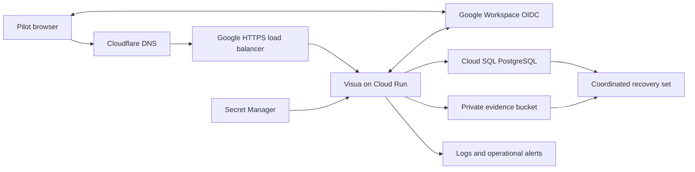

# Live deployment plan: Google Workspace and Cloudflare

Prepare a restricted Visua pilot in your Google Cloud organization, using
Google Workspace for sign-in and your Cloudflare-managed domain. This is a
deployment plan, not an executed deployment. Resolve the
[predeployment review](reviews/predeployment-review-2026-10-14.md) before
admitting real evidence. No cloud resources, billing accounts, DNS records, or
identity settings were changed during the review.

## Decisions and open inputs

You selected Google Workspace and Cloudflare and asked to include Google Cloud
setup. You will provide domain names later. The remaining inputs determine the
resource configuration and estimate; none of the placeholders is a real target.

| Decision | State | Needed before |
| --- | --- | --- |
| Google Cloud organization, project, and billing | Include new setup; identifiers pending | Provisioning |
| Workspace email domain and bootstrap owner | Pending | OAuth registration and first sign-in |
| Cloudflare zone and application hostname | You will supply later | DNS, certificate, and callback registration |
| Region and data residency | Pending | Database, object storage, and backup selection |
| Pilot users, concurrent activity, artifact volume | Pending | Sizing and capacity acceptance |
| Monthly budget | Pending | Resource estimate and creation |
| Internal-only users or external auditors | Internal-only pilot proposed; confirm participants | OAuth audience and invitations |
| Retention, deletion rights, recovery objectives | Pending named operator decisions | Real evidence admission |
| Service, identity, recovery, and incident owners | Unassigned | Operational acceptance |

Use separate staging and production resources and secrets. Start with an empty
installation; the existing local demo database stays local. Importing existing
assessment data would require its own reviewed migration and reconciliation.

## Proposed architecture

Use a Node container on Cloud Run, Cloud SQL for PostgreSQL, and a private
S3-compatible evidence bucket. Cloudflare R2 is a candidate for that bucket;
its compatibility and recovery gates below must pass before selecting it.
This reuses the current application, SQL backend, and blob adapter.

The diagram shows DNS resolution as part of the access path; DNS does not proxy
application requests. Use a Google external Application Load Balancer with a
serverless backend and a certificate for the chosen hostname. Google recommends
this custom-domain path; direct Cloud Run domain mapping remains Preview.
Point only the application DNS records at the load balancer. Preserve Workspace
MX, SPF, DKIM, DMARC, and verification records.
[Google custom-domain options](https://docs.cloud.google.com/run/docs/mapping-custom-domains).

Start with Cloudflare DNS-only records so the first acceptance run has one HTTP
proxy layer. If you subsequently enable Cloudflare proxying, use **Full (strict)**,
retain a valid origin certificate, bypass cache for authenticated/API responses,
and repeat uploads, OIDC callbacks, and event-stream reconnect tests. Choose and
verify an origin access policy before relying on Cloudflare-only enforcement.
[Cloudflare TLS mode](https://developers.cloudflare.com/ssl/origin-configuration/ssl-modes/full-strict/).

### Runtime and database constraints

Cloud Run must supply CPU between requests because Visua uses timers for runs,
leases, score observations, and domain rechecks. Plan instance-based billing
with at least one minimum instance. Minimum instances do not guarantee that a
particular process survives; exercise restart and lease recovery. This has a
standing cost that belongs in the estimate.
[Cloud Run CPU and billing](https://docs.cloud.google.com/run/docs/configuring/billing-settings).

Build an immutable `linux/amd64` image, retain its digest and source revision,
and scan its actual packages and base OS. Configure container port **8787** and
`VISUA_PORT=8787`, with `VISUA_HOST=0.0.0.0`; Visua does not consume Cloud Run's
generic `PORT` setting. Container files are ephemeral, so SQL and evidence must
use external storage. Test termination within Cloud Run's ten-second window;
choose an application shutdown deadline with margin after measuring the drain.
[Cloud Run container contract](https://docs.cloud.google.com/run/docs/container-contract).

Use a dedicated database and application role. The current startup performs
migrations using that role, so a future split between migration and runtime
roles needs an implemented migration entry point; it is not already supported.
Initialize one instance before scaling out. Each application process can consume
ten pooled connections plus one event-listener connection. Include rollout
overlap, recovery tools, and administration in the database connection budget.
The connection path must support persistent `LISTEN/NOTIFY` sessions.

Prove the Cloud SQL connection method with the exact image. Cloud SQL supports
Cloud Run integrations through connectors, sockets, and private connectivity.
Visua currently accepts a PostgreSQL connection string; it does not embed the
Google connector library. Select an authenticated proxy/socket or verified TLS
path that the driver and preflight both support. Do not disable certificate
verification to make a connection work.
[Cloud SQL connection guidance](https://docs.cloud.google.com/sql/docs/postgres/connect-run).

Keep Cloud Run ingress restricted to the chosen load-balancer path. Application
OIDC handles user sign-in; verify the platform invoker configuration with that
browser flow. Test the default service URL cannot bypass the intended ingress.
Do not assume end-user IP rate limits work through the proxy: current application
limits use the direct peer and may combine users behind it. Validate edge and
application admission together before increasing instance counts.

### Google Workspace identity

Create the Cloud project under the Workspace-associated organization. Configure
an OAuth web client and **Internal** audience for the proposed employee-only
pilot. Register the exact callback
`https://<VISUA_HOSTNAME>/api/auth/oidc/callback`, and request only
`openid email profile`. Use Google's issuer `https://accounts.google.com` and
retain the client secret in Secret Manager. Add explicit Visua members and roles;
keep organization JIT provisioning disabled until review finding F01 is fixed.
[Google OAuth audience setup](https://developers.google.com/workspace/guides/configure-oauth-consent)
and [Internal audience requirements](https://support.google.com/cloud/answer/15549945).

Verify owner bootstrap, a permitted member, a nonmember, and an outside account
with the actual provider. Visua uses issuer/subject identity and verified email;
it currently has no Google-specific `hd` claim policy. Google's `hd` request
hint is not an authorization boundary. If access is to depend on Workspace
membership beyond the Internal-client restriction, implement and test the
verified `hd` claim requirement before claiming that restriction. External
auditors need a deliberate audience/access design.
[Google OIDC claims](https://developers.google.com/identity/openid-connect/reference).

### Evidence storage and recovery

For R2, create private buckets with separate application and recovery access.
Use bucket-scoped S3 credentials, the account's HTTPS S3 endpoint, and region
`auto`; store credential values in Secret Manager. Leave public bucket access
disabled. Test Visua's exact SHA-256 upload, subsequent verified read, review,
download, and cleanup behavior with the installed AWS SDK before selection.
The local MinIO rehearsal establishes no R2-specific result.
[R2 S3 setup](https://developers.cloudflare.com/r2/get-started/s3/).

Do not assume S3 bucket versioning exists on R2: its compatibility table lists
`PutBucketVersioning` as unsupported. Visua stores its own artifact identifiers
but does not manage provider version retention. Pair a stopped-writer SQL
snapshot with separately retained artifact copies and a manifest under distinct
recovery credentials, or select another proven recovery design. Test missing
and corrupt objects and restored reviews against independently retained pins.
Confirm residency and retention suitability before choosing the bucket.
[R2 compatibility](https://developers.cloudflare.com/r2/api/s3/api/).

## Deployment sequence and gates

Complete these stages in order. Each gate records revision, operator, time,
expected result, actual result, and evidence. A failed or missing gate stays open.
Assignments below name functions, not people who have already accepted ownership.

| Stage | Work and exit evidence | Responsible function |
| --- | --- | --- |
| 1. Resolve review | Fix or explicitly disposition every finding. Prioritize F01 admission, F02/F03 database failure handling, and the failing browser check. Complete the interrupted independent security review. Recheck affected paths and the full suite. | Application maintainer and independent reviewer |
| 2. Establish accounts | Verify Workspace organization, create staging/production Google projects, link billing, choose region, budget controls, and operator access. Record a priced bill of materials before creation of runtime services. | Cloud and identity owners |
| 3. Define infrastructure | Prepare reviewable infrastructure definitions for registry, service identity, secrets, SQL, bucket, load balancer, certificates, DNS, logs, backups, and deletion protection. Keep secret values out of source and plans. | Cloud operator |
| 4. Build release | Pin source/base/image identities; remove unnecessary tooling or document exceptions; retain SBOM and OS/package scans. Run the full check and failure fixtures in the target runtime. | Release owner |
| 5. Prepare staging | Create isolated database/bucket, configure OAuth and HTTPS, load secrets, run preflight, start one empty instance, inspect migration and bootstrap. Verify no demo accounts/data exist. | Cloud and identity owners |
| 6. Prove application | Exercise all four roles, cross-organization denial, assigned CSF/SOC 2 work, reject/replace/accept evidence, exact download, pinned auditor ZIP, and keyboard/mobile journeys. | Pilot reviewer |
| 7. Prove operations | Test database disconnect/stall, process replacement, dropped SSE, membership removal, object failure, coordinated restore, and realistic concurrent read/write/upload/export/run load. Record recovery and alert delivery. | Recovery and service owners |
| 8. Prepare production | Create production-specific identities/secrets/data resources. Apply the tested revision/configuration, repeat preflight and smoke, and validate routing/certificates. Keep general admission closed until evidence is reviewed. | Release owner |
| 9. Admit pilot | Add named users, retain their acceptance record, watch backlog/errors/storage/costs, and record the first operating period before broadening access. | Accountable service owner |

Stages 2–3 can be planned while fixes are developed. Live provisioning and
cutover are separate execution work after this review and plan.

### Required configuration

Record secret references and exact nonsecret settings for each environment.
Use the existing [preflight](operations.md#configuration-preflight), which checks
syntax and leaves real provider checks open.

| Setting | Planned value or constraint |
| --- | --- |
| `NODE_ENV`, `VISUA_AUTH_MODE`, `VISUA_SEED` | `production`, `oidc`, `0` |
| `VISUA_PUBLIC_URL` | Exact HTTPS application origin, pending hostname |
| `VISUA_SECRET` | Generated nondefault secret; preserve for encrypted SSO recovery |
| `VISUA_OIDC_ISSUER` | `https://accounts.google.com` |
| `VISUA_OIDC_CLIENT_ID`, `VISUA_OIDC_CLIENT_SECRET` | Environment-specific registered client and secret reference |
| `VISUA_BOOTSTRAP_OWNER_EMAIL` | Named permitted Workspace owner, pending |
| `VISUA_DATABASE_URL` | Selected Cloud SQL connection path and protected credentials |
| `VISUA_BLOB_STORE` | `s3` |
| `VISUA_BLOB_S3_BUCKET`, `VISUA_BLOB_S3_REGION` | Private selected bucket; `auto` if R2 is accepted |
| `VISUA_BLOB_S3_ENDPOINT`, `VISUA_BLOB_S3_PREFIX` | Selected HTTPS endpoint and environment-owned prefix |
| `AWS_ACCESS_KEY_ID`, `AWS_SECRET_ACCESS_KEY` | Bucket-scoped R2 credentials if R2 is selected |
| `VISUA_AGENT_MODE` | `offline` for initial infrastructure acceptance; live models need an explicit data/credential decision |
| `VISUA_REPO_SCAN_ROOTS` | `[]` until specific trusted repository mounts are approved |
| OIDC HTTP/email trust overrides | Disabled; retain DNS verification and rechecks |

Choose CPU, memory, concurrency, instance ceiling, SQL tier, backup storage, log
retention, and alert thresholds after the region, budget, and workload are known.
Include the always-running service, database, load balancer, network egress,
evidence backups, logs, secrets, and any later model usage in the estimate. No
monthly price or capacity promise has been established.

## Recovery, cutover, and acceptance

Before the first production write, assign backup/key custody and test restoration
to a fresh SQL database and private artifact destination. Preserve SQL roles,
provider configuration, and the original `VISUA_SECRET` alongside protected
backup references. A database point-in-time recovery without corresponding
artifact bytes is insufficient. Record measured recovery time and backup age.

During an upgrade, stop all writers and retain a verified coordinated backup.
If acceptance fails, stop the new revision and preserve its state. Restore to
new destinations and run the compatible previous image; do not assume a traffic
rollback reverses migrations. Check audit continuity, accepted artifact bytes,
roles, and sign-in before returning traffic. Reconcile any writes after the
backup explicitly; never silently discard them.

The admission record must include the resolved review, exact image/configuration,
real Google login results, private object access, provider recovery, capacity,
alert ownership, retention decisions, and participant acceptance. Use the
[pilot worksheet](pilot-acceptance.md) for the workflow measurements. Local tests
and review completion alone do not authorize a claim of hosted readiness.
