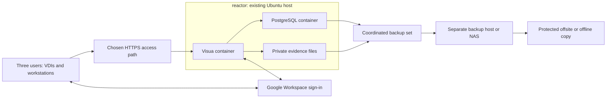

# Live deployment plan: XTK Systems office

Deploy a three-user Visua pilot on XTK Systems' office infrastructure. This
replaces the earlier Google Cloud hosting proposal. Google Workspace sign-in
and the Cloudflare-managed domain remain the working identity and DNS choices.
On October 28, 2026, you selected SSH host `reactor`. Visua is now installed
privately there with PostgreSQL and local evidence. Its listener is
`127.0.0.1:8787`; Google OAuth, the owner email, and the final HTTPS hostname
remain pending. See the [reactor runbook](../deploy/reactor/README.md).

The [predeployment review](reviews/predeployment-review-2026-10-14.md) still
holds release. Its independent plan review covered the
[earlier Google Cloud proposal](https://github.com/xtksystems/visua/blob/e3149dd11f1fa67b4955b4eec3d998aa82be284e/docs/live-deployment-plan.md),
not this office topology. All sizing below is a proposal pending inventory and
acceptance measurements, not a hardware inspection or capacity guarantee.

## Confirmed inventory and open inputs

The following inventory comes from your description. Device counts do not
establish available CPU, memory, disk capacity, or resilience.

| Item | Reported state | Placement implication |
| --- | --- | --- |
| Visua users | Three | One application instance is the proposed starting point. |
| Dell 7920 machines | Six, used as local servers | Operating systems, workloads, and spare capacity pending. |
| Windows Server hosts | Two, running Hyper-V | Whether these are included in the six Dells is pending. |
| Windows 11 VDIs | Three on each Windows Server; six VMs total | Existing workloads must retain their resources. |
| Windows 11 workstations | Two | Browser clients and administration endpoints. |
| Identity and domain | Google Workspace and Cloudflare from the earlier brief | Exact Workspace domain, hostname, and owner supplied later. |
| Network and recovery | Not yet described | Confirm LAN/VPN versus remote browser access, backup destination, UPS, and recovery objectives. |

Before allocating a VM, identify the Windows Server versions, supported guest
OS, free RAM/SSD capacity during busy VDI use, storage health, and host maintenance
windows. Record the selected host and a different machine or NAS for backups.
Do not assume the Windows hosts are additional to the six Dell machines.

## Proposed architecture

The selected host is the existing Ubuntu 24.04 machine `reactor`, with Docker
Engine and Compose. No additional Hyper-V VM was created. It runs one private
Visua instance, PostgreSQL, and persistent local evidence volumes. The original
Hyper-V proposal below remains an option for later isolation or recovery.
Independent backup storage and final HTTPS ingress remain open preparation.

For a future VM, use Ubuntu Server 24.04 LTS as the guest candidate, subject to the actual
host version and patch policy. Microsoft's support matrix includes this guest
on Windows Server Hyper-V, and Docker documents its Ubuntu Engine installation.
Use Linux containers inside this VM; leave the existing Windows 11 VDIs as
clients. [Microsoft guest support](https://learn.microsoft.com/en-us/windows-server/virtualization/hyper-v/supported-ubuntu-virtual-machines-on-hyper-v)
and [Docker Engine on Ubuntu](https://docs.docker.com/engine/install/ubuntu/).

The original VM sizing proposal was **4 vCPU, 8 GiB RAM, an 80 GiB OS disk, and a
separate 200 GiB data disk**. These are provisional allocations, not minimum
requirements. Adjust to measured host headroom, evidence volume, database growth,
and temporary export/backup space. Separate virtual disks on one host do not
create an independent failure domain. No GPU is proposed for the server.
Test rendering and interaction on the actual Windows 11 VDI sessions. Reactor
reported 478 GiB available RAM and 713 GB free root disk at installation. The
app has a 4 GiB memory ceiling and PostgreSQL 2 GiB; these are container ceilings,
not reserved resources or a capacity benchmark.

Use one active application VM initially. A second host can be a tested manual
recovery destination if capacity permits; it is not automatic failover. Multiple
application replicas with host-local evidence would not share artifact bytes.
Adding replicas requires a separately designed shared-storage and recovery path.

### Storage choice and preparation gaps

PostgreSQL plus local evidence uses existing runtime adapters and avoids adding
an object-storage service for this three-user installation. Pin and scan the
selected PostgreSQL 17 image; the repository's local rehearsal exercises major
version 17. Keep SQL on a private container network with no host-published port.
Persist SQL and artifact volumes on operator-owned Linux filesystems with tested
permissions and sufficient free space.

SQLite plus local files remains an alternative for a strictly single-instance
installation, with an existing stopped-writer backup helper. PostgreSQL is the
proposed baseline because it is the repository's designated production backend.
This is an operational choice, not a claim that three users require PostgreSQL.
F02/F03 database resilience repairs remain release prerequisites for this choice.

The reactor packaging now addresses these preparation gaps with bounded checks:

- `pnpm pilot:preflight` still requires **PostgreSQL and S3**. The separate
  [reactor preflight](../deploy/reactor/preflight.py) checks the office profile
  and reports identity configuration separately. Private staging checks pass;
  its required identity check currently fails because OAuth is absent.
- `scripts/backup-local.ts` still supports **SQLite/local files only**. The new
  [reactor backup](../deploy/reactor/backup.py) captures PostgreSQL/local files
  while the app is stopped. The initial backup restored into fresh destinations;
  a separate synthetic drill restored exact bytes, review, audit/revision, and
  auditor content. Off-host copies and operational retention remain pending.

The repository's [compose.yaml](../compose.yaml) remains a development
demonstration. Reactor uses the separate
[production-mode definition](../deploy/reactor/compose.yaml), dedicated secrets,
and private networks. Developer sign-in and demo seeding are disabled.

## Access and identity

The access choice remains open. The baseline recommendation is the office LAN
and an existing or separately configured VPN. Remote browser access through
Cloudflare is an alternative if that better fits how the three users work.

| Access path | Configuration and acceptance |
| --- | --- |
| Office LAN/VPN | Resolve the owned hostname to the private HTTPS ingress using internal DNS. Provision a browser-trusted certificate and renewal, with DNS validation where appropriate. Permit only the intended LAN/VPN and management routes. Verify the registered Google callback from those clients. |
| Remote browser through Cloudflare | Create a self-hosted Access application allowing the three named identities, then publish the hostname through an outbound Tunnel. Configure Access token validation at the connector, keep direct origin access closed, and test both Access and Visua sessions. |

Tunnel does not require a publicly routable origin IP. Cloudflare recommends
creating the Access application before publishing the tunnel route and supports
connector-side token validation. This option still depends on office Internet
and power. Application requests and evidence transfers traverse Cloudflare;
on-premises storage does not mean all processing stays inside the office.
[Cloudflare Tunnel](https://developers.cloudflare.com/cloudflare-one/networks/connectors/cloudflare-tunnel/)
and [self-hosted Access applications](https://developers.cloudflare.com/cloudflare-one/access-controls/applications/http-apps/self-hosted-public-app/).

For either route, expose only the selected HTTPS ingress. Keep application port
8787 restricted to the proxy/connector and SQL private. Test SSE delivery and
reconnect, upload limits, large auditor downloads, and certificate renewal.
Cloudflare Access is an additional admission layer; Visua still needs its own
OIDC sessions and roles. Do not infer a Visua role from an unverified proxy header.
Preserve Workspace MX, SPF, DKIM, DMARC, and verification records during DNS work.

Retain a Google Cloud project for OAuth registration, under the Workspace
organization. Cloud Run, Cloud SQL, R2, and a Google load balancer are no longer
selected resources. The earlier cloud-hosting billing work is superseded;
identity registration and any separately chosen paid services are distinct work.
Configure an Internal OAuth web client for the proposed employee-only pilot,
scopes `openid email profile`, and callback
`https://<VISUA_HOSTNAME>/api/auth/oidc/callback`. Keep the client secret in an
operator-controlled secret store. [Google OAuth setup](https://developers.google.com/workspace/guides/configure-oauth-consent).

Bootstrap the named owner, add the other two named members, and assign roles
according to their work. Keep organization JIT disabled until F01 is repaired
and independently checked. Test a permitted member, a nonmember, an outside
account, member removal, and restore of encrypted SSO settings. The application
has no Google-specific `hd` claim policy; do not claim domain restriction from
an email suffix or login hint alone. External auditors need a separate audience
and membership decision. New sign-ins depend on Internet access to Google.

## Production configuration to prepare

Record exact nonsecret settings and secret references for staging and production.
Keep secrets outside Git, out of process logs, and recoverable independently.
The application consumes environment values; a container secret file alone does
not inject them without an explicit, reviewed startup mechanism.

| Setting | Office profile |
| --- | --- |
| `NODE_ENV`, `VISUA_AUTH_MODE`, `VISUA_SEED` | `production`, `oidc`, `0` |
| `VISUA_PUBLIC_URL` | Exact HTTPS hostname, pending |
| `VISUA_HOST`, `VISUA_PORT` | `0.0.0.0`, `8787` inside the private container network |
| `VISUA_SECRET` | Generated nondefault secret, retained for SSO recovery |
| `VISUA_OIDC_ISSUER` | `https://accounts.google.com` |
| `VISUA_OIDC_CLIENT_ID`, `VISUA_OIDC_CLIENT_SECRET` | Registered client and protected secret |
| `VISUA_BOOTSTRAP_OWNER_EMAIL` | Named Workspace owner, pending |
| `VISUA_DATABASE_URL` | PostgreSQL URL on the private container network; protected credentials |
| `VISUA_BLOB_STORE`, `VISUA_BLOB_DIR` | `local`, `/app/data/blobs`, backed by a persistent volume |
| `VISUA_AGENT_MODE` | `offline` for infrastructure acceptance; external models require a separate data/credential decision |
| `VISUA_REPO_SCAN_ROOTS` | `[]` until specific trusted repository mounts are selected |
| OIDC HTTP/email-trust overrides | Disabled; retain domain verification and rechecks |

Use an immutable application image with source revision and digest, persistent
volumes, restart policy, readiness checks, and a stop grace period exceeding the
configured application drain deadline. Preserve the non-root container user and
test volume ownership before starting. Record CPU/RAM use, disk space, container
restarts, database errors, backup freshness, and certificate/tunnel status from
outside the application VM where possible. Test delivery of an operational alert.

The infrastructure inventory does not authorize automated scans of those servers.
Current web-posture connectors target public endpoints; Hyper-V/Windows inventory
collection would be separate integration work.

## Backup and recovery

Choose a named operator, backup destination, retention schedule, and recovery
objectives before real evidence admission. An initial proposal is a nightly
backup plus one before every upgrade. That schedule can lose up to a day's work;
set the schedule from the acceptable data-loss window and measure recovery time.
UPS protection, host backup, RAID, and VM checkpoints complement this procedure;
none replaces a verified database-and-artifact recovery set.

Prepare this procedure as an executable, tested runbook before production:

1. Stop every Visua writer and keep them stopped through SQL and artifact capture.
   Keep PostgreSQL running for a compatible `pg_dump` custom-format archive.
2. Copy the complete private artifact tree while it is unchanged. Record file
   identifiers, sizes, hashes, source revision, database archive hash, and audit
   checkpoint in a recovery manifest. Validate referenced artifacts against SQL.
3. Preserve database roles/configuration and the corresponding `VISUA_SECRET`,
   OAuth registration, and deployment secrets through protected recovery custody.
4. Verify the complete set, copy it to independent backup storage, and retain a
   separate manifest digest. Keep a protected offsite or offline copy for office
   loss. Resume service and verify readiness and an exact evidence download.
5. Restore to a **fresh database and fresh artifact volume** on an isolated VM.
   Use compatible `pg_restore` with errors treated as failures; never clean or
   overwrite the live database as a drill. Point the test app at restored paths.
6. Check exact artifact downloads, reviews, tasks, audit continuity, access
   records, roles, restored SSO, and externally pinned auditor bundles. Record
   elapsed time, backup age, and every discrepancy.

The [operations guide](operations.md#postgresql-and-object-storage) supplies the
SQL dump/restore constraints; adapting capture to local files and proving the
combined restore is new preparation work. An image rollback alone cannot undo
startup migrations. On upgrade failure, stop and preserve the new state, restore
new destinations, run the compatible prior image, and reconcile later writes.

## Deployment sequence and gates

Complete these stages in order; inventory and packaging design can proceed while
application repairs are developed. Record actual evidence against each gate.

| Stage | Work and exit evidence |
| --- | --- |
| 1. Repair and review | Resolve or explicitly disposition F01–F11 and T01. Prioritize admission, PostgreSQL disconnect/stall handling, and the failed browser test. Complete missing independent security coverage. Run affected regressions and the full check. |
| 2. Confirm placement | Identify host/version/headroom, Linux guest, network path, three users, backup destination, UPS, and operators. Confirm existing VDI workloads remain healthy. |
| 3. Prepare office packaging | Produce a production Compose definition, office preflight profile, secret injection, persistent volumes, HTTPS configuration, backup/restore runbook, and alerts. Validate without live data. |
| 4. Stage | Use isolated staging data and credentials; build/scan the release image, start an empty production-mode installation, and verify Google login plus denied access cases. |
| 5. Prove operations | Exercise PostgreSQL disconnect/stall, VM restart, power-loss recovery planning, disk/storage failure, network loss, and the fresh-VM restore. Measure representative concurrent use by all three users and verify VDI browser usability. |
| 6. Admit production | Create separate production data/secrets, register the final hostname, deploy the tested revision, repeat smoke and recovery checks, and add the named users. Keep local demo data separate. |
| 7. Operate | Retain acceptance, monitor the first operating period, verify scheduled backups/alerts, and rehearse recovery before expanding scope. |

The [pilot worksheet](pilot-acceptance.md) remains the acceptance record. The
[reactor delivery](../.codex-context/runs/reactor-deploy-20261028/state.json)
records the private installation and checks. Domain names will be supplied later.
Application findings, Google login, final access, off-host recovery, and user
acceptance remain open before live admission.
