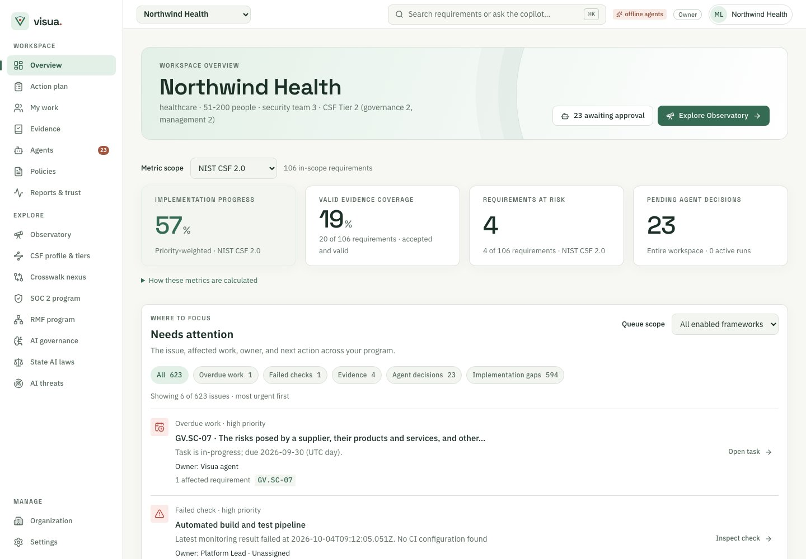
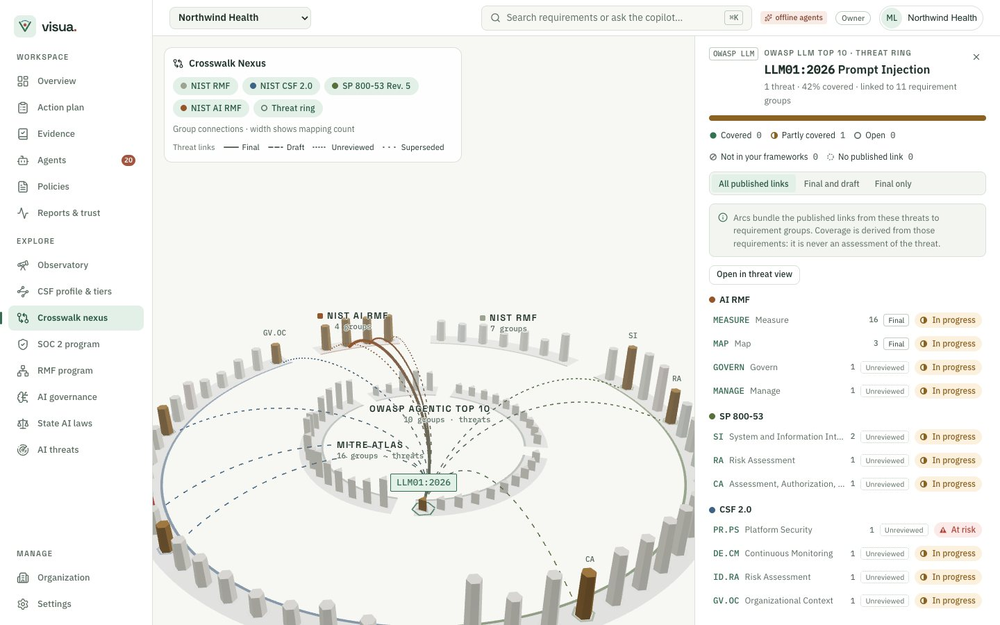

# Using the workspace

The Visua workspace brings program health, tasks, evidence, and framework
relationships into one place. This guide shows where to find the next action
and what to expect when you make a change.

## Find a destination

The labeled sidebar groups destinations by purpose. **Workspace** contains
**Overview**, **My work**, **Action plan**, **Evidence**, **Agents**, **Policies**, and
**Reports & trust**. **Explore** contains the Observatory, Crosswalk nexus,
and framework programs. **Manage** contains organization and workspace
settings.

Use search in the top bar, or press `⌘K` on macOS or `Ctrl+K` on Windows and
Linux, to find requirements and read official passages. Contributors and above
can also ask the copilot. On screens narrower than 1024
pixels, open the labeled menu from the top bar.

## Use your role's controls

Viewers can browse requirements, tasks, evidence, policies, and program settings.
Auditors can also export workspace records. Contributors can change work and run
agents or existing connectors. Approvers can also make review, applicability,
and authorization decisions. Admins and owners configure workspaces and add
connectors. Organization administration follows your organization role.

Controls for changes your role cannot make are hidden or disabled. Viewing,
navigation, search, and filters remain available. If a change fails, an error
message appears and its unsaved input remains available to correct or retry.

## Review program health

**Overview** separates recorded implementation from accepted proof. Choose
**Metric scope** to inspect an enabled framework. **Implementation progress**
measures priority-weighted progress toward its targets. **Valid evidence
coverage** counts requirements with accepted, currently valid evidence.
**Requirements at risk** counts requirements whose current status is at risk.
Each metric names its scope or denominator. **Pending agent decisions** covers
the entire workspace. Open **How these metrics are calculated** for the
formulas, exclusions, and update time.

Framework cards show implementation progress, status distribution, scope, and
valid evidence coverage. Choose **Program** to open the framework's 2D view or
**View in 3D** to explore it in the Observatory.



**Needs attention** appears above the framework cards. It includes overdue
tasks, current failing checks, expired or expiring evidence, pending reviews,
and implementation gaps across all enabled frameworks. Each issue shows its
reason, linked work, owner or reviewing role, and a direct next action.
Use **Queue scope** or the issue filters to narrow the complete queue; choose
**Show more issues** to reveal further results in urgency order.

Review status and validity are separate. A pending artifact can already be
expired. Expiry messages identify other evidence that is valid now; they do
not forecast future coverage. Links to requirement groups do not establish
evidence coverage for their individual requirements. Metrics and the queue
refresh every minute and after relevant workspace changes. Failed loads offer
retry instead of reporting that no work remains.

**Observed score history** appears below the current overview. A contributor
can choose **Record snapshot**; scheduled capture also records an observation
every 24 hours while enabled. Choose a framework to compare its recorded
implementation progress and valid evidence coverage. The table gives exact
numerators, denominators, risk counts, observation times, and comparison notes.

History begins with the first recorded observation. It never reconstructs
earlier scores or fills missed days. Scope, target, priority, catalog, or
calculation changes interrupt chart lines, as do gaps longer than 36 hours or
an intervening observation without that framework. The latest 60 workspace
observations are shown; older observations remain stored. These are sampled
observations, not continuous monitoring. On narrow screens, scroll the chart
and table horizontally within their panels. Expand the details for the scope
and targets behind each point.

## Review agent changes

Open a proposal from **Needs attention**, an agent run, or the **Approvals
inbox**, then choose **Review changes**. Compare **Current** and **Proposed**
values, affected requirements, supporting sources, and unknowns before making
a decision. Agent confidence is a qualitative assessment, not verification.
The flight recorder remains below the proposals; runtime and token counts are
under **Run details**.

Runs show **Collect → Analyze → Propose → Review → Apply** from recorded
lifecycle facts and proposal outcomes. The active stage and any blocker are
visible. Older runs show unrecorded stages explicitly; answer-only runs do
not imply changes were applied. Decisions under granted autonomy are labeled
separately from explicit approvals and rejections. Failed, rejected, cancelled, and mixed outcomes
remain visible rather than completing the whole sequence.

An approver, admin, or owner can choose **Approve and apply** or **Reject
proposal**. The review stays fixed while open. If the proposal or workspace
changes before approval, choose **Refresh preview**, inspect it again, and
retry. Generated identifiers and decision timestamps are marked as values set
when the proposal is applied. File evidence is reviewed through its artifact
detail screen, where bytes are verified.

Under **Settings → Agent autonomy**, you can allow **Create tasks** and
**File recorded checks**. Filing checks uses their immutable recorded observation.
Generated narratives and assessment, scope, target, policy and task-update changes
still require human review. Earlier grants for other change types no longer apply;
saving these settings replaces them with the two supported choices.

Crosswalk proposals display the source assessment, mapping authority, relationship
and calculated suggestion. A mapping does not establish accepted proof. Weak or
conflicting mappings require direct assessment, and changes to source assessments
invalidate the earlier projection. Quoted passages identify their corpus source;
they do not verify the organization or prove an attached conclusion.

Cancelled runs cannot continue writing proposals. If a worker lease expires, the
run shows an interruption; inspect any existing proposals before starting again.

For a run with multiple pending proposals, **Review all** opens a batch summary
and every proposed change. **Approve reviewed** processes only the proposals
in that review. New arrivals are excluded. Conflicting changes to the same
target are skipped and remain pending for individual review. The result reports
the actual applied, failed, and skipped counts; a failure is never reported as
an applied change.

## Move work forward

**Action plan** opens as a list ordered by blocked work, overdue work, review
work, work due today or within seven days, other open work, then completed
work. Priority and due date break ties. Each row includes an owner and next
action. Status counts stay visible and reflect the selected framework before
the status filter. View, framework, status, and selected task are in the URL.

**Board** keeps six status columns in a horizontally scrollable region.
**Timeline** includes a point marker for tasks with only a due date; it never
invents a start date. Its schedule table also includes unscheduled tasks.
Dates use UTC; calendar dates remain due through their entire UTC day, while
older timestamp deadlines retain their exact instant. The **Generate plan**
action uses the workspace's primary framework.

1. Use **Generate plan** to create tasks from official implementation
   guidance for the primary framework, or use **Plan with agent** to request
   a proposed plan.
2. Enter a title in **Quick add a task**, then select **Add task** to create
   it in **To do**.
3. Open a task to review its checklist, status, dates, assignee, and linked
   requirements. Choose an organization member in **Assignee**, set **Due date**,
   and search for requirements to add or remove. Choose **Save task details** to record
   these changes or **Cancel task changes** to discard them. Status and checklist
   changes save individually.
4. On the board, drag a card to another status when you want to move it. The
   card moves immediately and shows **Saving…** until the server responds.

A card cannot be dragged again while its move is saving. If the save fails,
the card returns to its previous status and an error message appears. A
successful move remains in place while the workspace refreshes.

## Compare the CSF profile

**CSF profile & tiers** opens on the **Profile** tab. Category rows compare
current and target levels on one 0–4 scale, with labeled numeric values,
the gap between means, and the number of outcomes below target. Sort by
function, largest mean gap, lowest current level, or highest target level.
Select a category to inspect its in-scope requirements, status, and valid
evidence counts. Requirement links open the Observatory inspector.

An excluded or unavailable category has no score; it is not displayed as
zero progress. **How profile metrics are calculated** explains the scope,
priority-weighted implementation progress, and observation time. Category
means themselves are unweighted.

The **Tiers** tab holds the organizational questionnaire. Unsaved answers
survive switching tabs, a failed save, and temporary workspace refresh failures.
Saving records the assessment in
the audit trail. Readers can inspect both tabs; contributors and above can
save tier assessments.

## Find your assigned work

**My work** lists tasks and requirements assigned to your signed-in member
identity in the current workspace. Tasks show status, due dates, and requirement
links. Open a task to work its checklist or edit its details. Requirement code
links open the matching framework and inspector. Calendar due dates remain due through the UTC day. Overdue dates have a text
label, and you can include completed tasks in the list.

Choose a member from **Assign owner** in a requirement inspector, then choose
**Save owner**. Set **Requirement due date** and choose **Save due date**. These
fields save separately. Leaving a field doesn't save it; changing the selection
resets unsaved drafts. Members with read-only roles can see their assigned work
and follow its links.

For a consultant or team without an account, choose **External owner** and
enter a label. External labels don't grant access and don't appear in anyone's
**My work** list. You can later replace the label with a member assignment.
Existing owner labels and old task assignments remain visible. A legacy or
former-member task assignment must be cleared or replaced with a current member
before it can be assigned again.

## Review evidence

Contributors and above can add a file from **Evidence**. To upload an artifact:

1. Choose **Upload evidence**, then select a nonempty file. The file size limit
   is 10 MiB.
2. Enter the title, optional description, kind, and collection date. Set
   **Valid until** if the artifact expires, or leave it blank for no expiry.
3. Link at least one requirement from an enabled framework.
4. Select **Assurance type** and describe **Assurance scope**. Design evidence
   documents a control's intended design; operating evidence records activity;
   an attestation records an assertion. Use **Unspecified** when the scope is
   unknown. Enter both ends of an observation period if one is recorded.
5. Choose **Upload for review**. Visua verifies storage before adding the item
   as **Pending review** and opening its detail dialog. A failed upload keeps
   your draft and displays an error.

Open **Evidence** and select an item to inspect its artifact, source, linked
requirements, collection date, expiry, and review history. For an uploaded file,
the dialog shows its name, byte size, media type, and SHA-256. Choose
**Download file** to inspect it locally. Downloads check the stored size and
hash and require current workspace access. Files download as attachments.
An approver can accept or reject pending evidence from the detail dialog.
Rejection requires a reason. **Withdraw evidence** removes an artifact from
accepted coverage and also requires a reason. Both decisions remain in history.
If the artifact, its assurance scope, or another person's review changes while
you inspect it, use **Reload evidence** before deciding. Missing or corrupt
file bytes block download, acceptance, and rejection; withdrawal remains
available so an unusable artifact can be removed from coverage.

Acceptance covers a specific artifact hash, requirement list, validity window,
assurance claim, collection provenance, and replacement reference. Choose
**Edit assurance and links** to amend the claim. Changing content, structured
data, requirement links, assurance, collection date, or expiry returns the item
to **Pending review** and keeps earlier decisions.
Changing its title, description, or file name preserves approval. Uploaded file
bytes and storage references are immutable; upload a new item to replace a
file. A connector's raw observation and an approved policy artifact cannot be
edited; run the connector or approve a new policy version to collect another.

Collection details distinguish uploads, manual records, connector observations,
agent proposals, and approved policy versions. Recorded source references do
not follow later connector or policy edits. Older artifacts show **Not recorded**
where collection details are absent. Assurance labels describe the recorded
claim; acceptance does not certify audit sufficiency.

For a manual or uploaded artifact, choose **Upload replacement** to retain its
assurance scope and link the new file to its predecessor. A replacement only
suppresses an expired artifact's risk after acceptance, while valid, and for
the requirements it covers. Pending or withdrawn replacements do not clear
that risk. Independent failing monitoring checks still make work at risk.

The ledger counts accepted evidence only while its bound approval and dates are
currently valid. Expired evidence keeps its review history. An upgrade returns
legacy approvals to review because their original assurance scope was not
recorded. Legacy decisions remain visible in the item's history. The later
metadata/body storage migration preserves existing review decisions and audit
history.

In the Observatory requirement inspector, open **Evidence** to trace artifacts,
source observations, policy versions, reviews, and replacement history without
loading artifact bodies. **Evaluate a different time** applies the current
recorded metadata to a selected UTC time. It does not reconstruct earlier edits
or decisions. Open an artifact to inspect its body or download its file.

## Plan evidence renewal

In **Evidence**, choose **Renewal**, or open **Review evidence renewals** from
the overview. Select **Expired**, **Next 7 days**, or **Next 30 days**. The
future windows exclude expired artifacts, and the thirty-day window includes
the seven-day window. Deadlines are evaluated from the displayed server update
time; a calendar expiry remains valid through the end of its UTC day.

Each item shows review status separately from validity. An artifact can be
pending review and expired at the same time. An accepted review alone does not
make an artifact currently valid. Open **Inspect evidence** to use the existing
artifact review and download flow. Closing the dialog keeps your renewal view.

For expired artifacts, the view identifies linked requirements that lack valid
accepted evidence now. For upcoming expiries, it shows the first loss of
uninterrupted coverage based on accepted evidence already on file. Alternative
artifacts can extend coverage, but an artifact collected after a gap cannot
hide that earlier gap. Each requirement counts once in the summary, even when
several artifacts link to it.

These projections assume the current scope and recorded evidence stay unchanged.
They do not predict new collection, approval, or changes in requirement status.
Group links provide context without covering their descendants. Invalid dates
and artifacts without a deadline remain available for inspection rather than
being assigned an invented expiry. The view refreshes every minute and after
relevant workspace changes, with retry available if a refresh fails.

## Explore requirements and mappings

**Observatory** shows framework requirements as a spatial map. Open a
requirement to inspect its status, evidence, and tasks. Its 2D outline gives
you the same path through the framework; on a phone, the outline opens first
and the 3D scene is one tap away.

Use **Outline preset** to find **At risk**, **Missing evidence**, or
**Assigned to me** requirements. Presets include only requirements in the
workspace's current assessed scope. **At risk** uses the derived status;
**Missing evidence** means no currently valid, accepted evidence is linked
directly to the requirement. Evidence linked only to a parent group doesn't
cover its children. **Assigned to me** uses your member account, not an owner
label that happens to match your name.

Search within a preset with **Filter outline**. The URL retains the preset,
search, and selection. Matching counts exclude ancestor context and a selected
requirement outside the filter. The spatial map keeps the whole framework for
context while the outline narrows your results. Threat catalogs show derived
coverage and don't offer assessment presets. The labeled legend stays visible;
expand its explanation for more detail about the scene's encodings.

Tab to the selected outline row or the framework canvas before using scene
shortcuts. Arrow keys move between siblings, **Enter** opens the first child,
and **Backspace** or **Escape** moves to the parent. Press **/** to focus the
outline filter, **F** to frame the selection, or **L** to change lenses. These
shortcuts leave inspector fields, buttons, and open dialogs alone. Filtering
keeps your selection visible with its ancestors, labels context separately,
and limits tree navigation to visible rows. The inspector's selection context
lets you move to a parent or sibling without clearing your filter. On a phone,
the outline reserves room above the inspector sheet for surrounding rows.

Use **Left** and **Right** to change inspector tabs, or **Home** and **End** to
reach the first and last tab. **Tab** moves into the selected panel. Dialogs
keep focus inside while open; closing one restores the control that opened it.
**Escape** in a scope dialog closes the dialog and keeps your requirement
selected.

Requirement code links open the matching framework and selected requirement.
Press **Ctrl+K** or **Cmd+K** to open search, use **Up** and **Down** to choose a
result, and press **Enter** to follow it. Close an open decision dialog before
opening search.

Choose a member in **Assign owner**, or enter an external **Owner** label, then
choose **Save owner** to record it or **Cancel owner
change** to restore the saved value. Leaving the field does not save it.
Selecting another requirement resets inspector drafts, tabs, and dialogs.
A failed owner save keeps your draft; an update to the same requirement does
not replace a dirty owner field.

Workspace and requirement load failures retain their destination and offer
**Retry**. Requirement deep links remain available when details fail to load
and when you follow a mapping into another framework. Closing the inspector
removes its selection from the URL.

**Crosswalk nexus** shows how groups in different frameworks relate. Select a
group to hide unrelated links and see its mappings in the detail panel. The
opening view summarizes connections between frameworks; selecting a group
shows its individual connections. Solid, dashed, densely dotted, and sparsely
dotted threat links indicate final, draft, unreviewed, and superseded sources. The
searchable group list provides a 2D path through the same information. The
inner threat ring shows published links from threat catalogs to requirement
groups. A mapping suggests where work may apply; each requirement still needs
its own evidence.

Choose **Matrix** to compare two requirement frameworks. Select a row, column,
or cell to inspect its mapping records. Counts include every published record,
including separate records from different sets. Reversing the axes keeps each
record's original direction and relationship. Details show the recorded
authority, publication status, source, and any qualification. Pair, selection,
page, and evidence filters survive a URL reload.

Select an **Evidence artifact** to inspect its direct links across frameworks.
Review status and validity are shown separately. Group links provide context;
they do not cover child requirements, and mappings do not transfer accepted
proof. The matrix is available to readers and makes no assessment changes.



For implementation details, see the [web architecture](architecture.md#5-web-appsweb)
and the [design system](../DESIGN.md).

## Public trust measures

The trust center shows when its measures were evaluated, the selected framework
scope, and the implementation and evidence denominators. Open **Calculation
basis** or **Scope and limitations** for the calculation and time boundary.
Organization-authored headlines are labeled separately from computed measures.
Monitoring retains different targets and recorded configurations even when their
outcomes disagree. An old observation is not a guarantee of current performance.


## Prepare an auditor handoff

In **Reports & trust**, select enabled frameworks and, optionally, a UTC review
window. **Open auditor view** prepares a read-only view of requirements, current
and target levels, exclusions, evidence validity, and recorded review status.
It does not fetch artifact content into the preview. Changing workspace clears
its capture. Failed preparation preserves the inputs for another attempt.

**Download auditor package** creates one ZIP containing the frozen assessment,
actual evidence bytes, supporting records, reports, source metadata, and an
offline presentation. The end date evaluates the current recorded data at that
instant; it does not reconstruct how records looked before later edits or prove
continuous assurance across a period. Missing source records and unavailable
historical policy bytes are identified. Review status and effective validity stay
separate.

Save the displayed **Download receipt** outside the ZIP. It contains the manifest
SHA-256 and audit checkpoint. Extract the package into a private directory and run
a separately trusted verifier with the retained receipt values:

```sh
node /trusted/bundle-verifier.mjs /path/to/extracted-package \
  --manifest-sha256 MANIFEST_HASH --checkpoint WORKSPACE_ID:SEQUENCE:CHAIN_HASH
```

A bundled verifier and bundled hashes alone establish internal consistency, not
independent authenticity. A retained manifest digest binds file content; a retained
checkpoint binds the audit chain. Verification never constitutes certification or
an auditor opinion. See [operations](operations.md) for recovery and retention.

**Load recent access records** displays separate records for prepared auditor
views, exports, and file downloads. The server supplies the actor; “Prepared” does
not establish that a person received or read a response. Viewing these records
does not change the assessment's audit chain. Auditors have no assessment write
controls, and all downloads still require current access.
